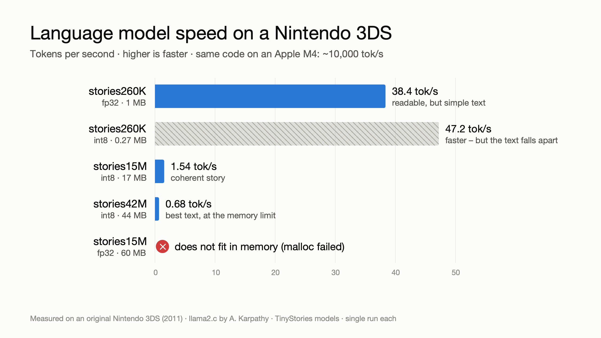
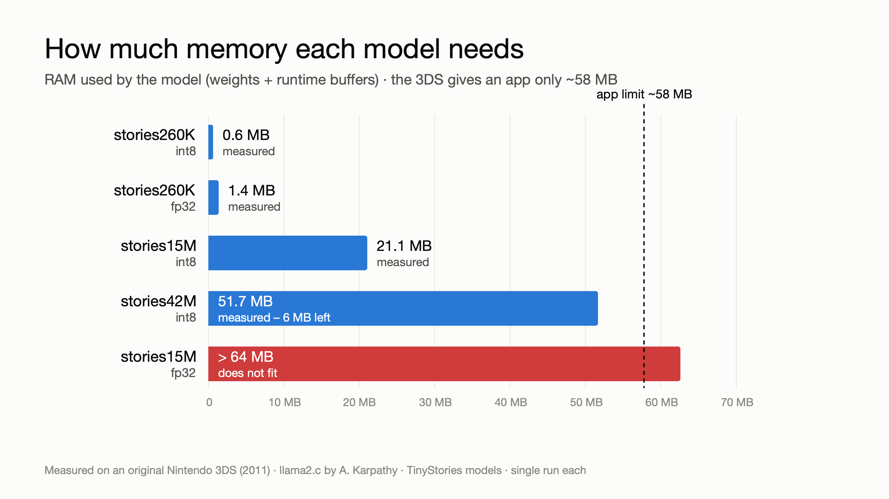
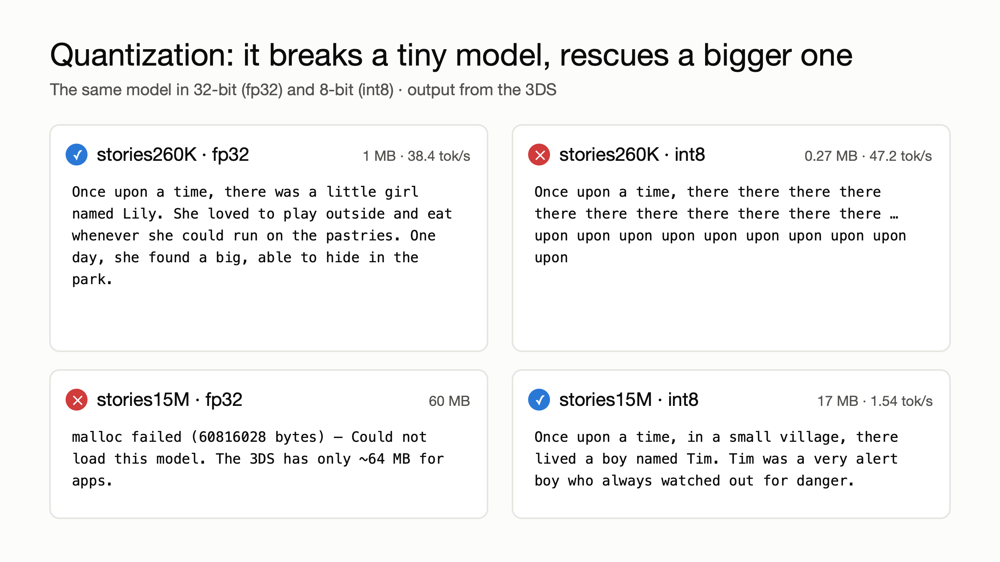
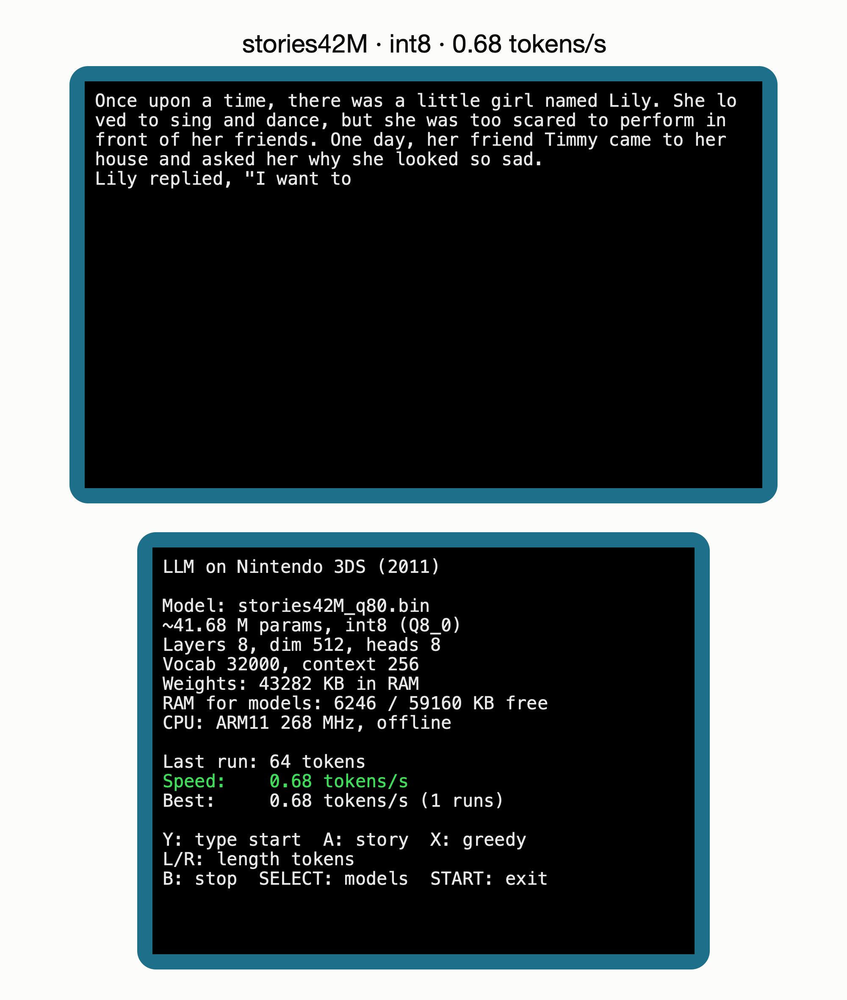
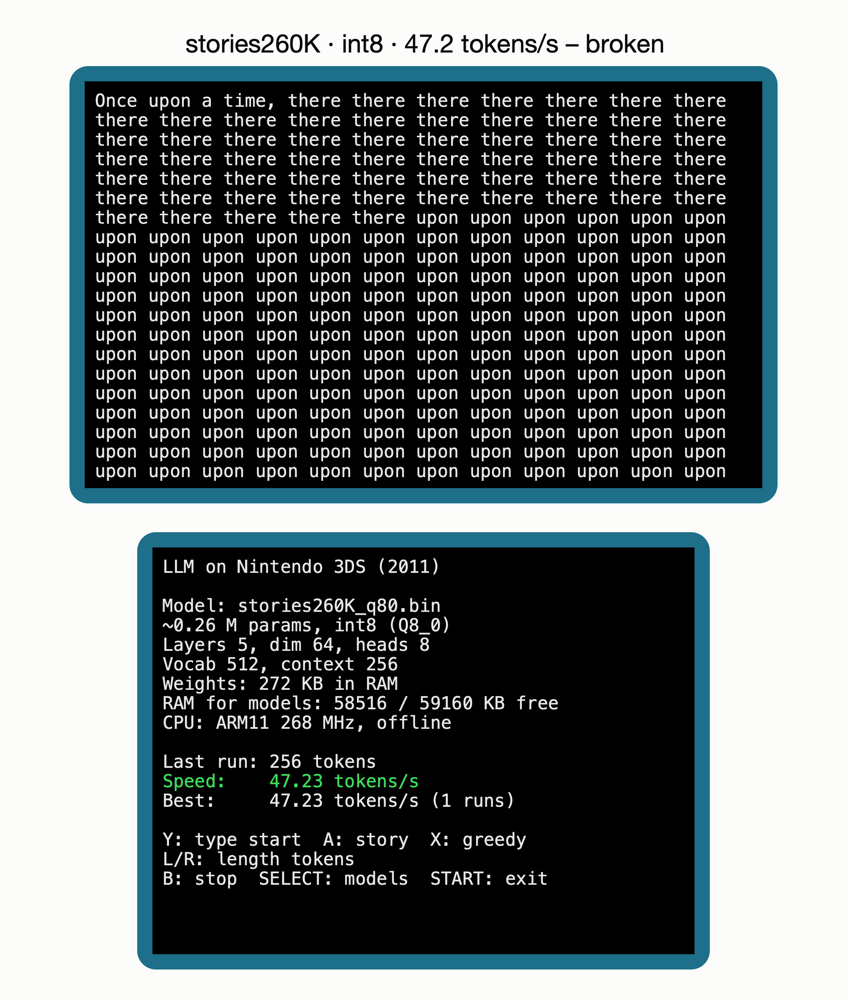

# LLM on Nintendo 3DS

A real Llama-architecture language model running **fully offline on an original Nintendo 3DS (2011)**:
ARM11 at 268 MHz, 128 MB RAM (~64 MB available to apps), no vector instructions.

Built on [llama2.c](https://github.com/karpathy/llama2.c) by Andrej Karpathy, with the
[TinyStories](https://arxiv.org/abs/2305.07759) models from
[karpathy/tinyllamas](https://huggingface.co/karpathy/tinyllamas). These models continue
simple English children's stories – they are not chatbots.

## Results (original 3DS)

| Model | Params | Format | Size | Speed |
|---|---|---|---|---|
| stories260K | 0.26 M | fp32 | 1 MB | **38.4 tokens/s** – simple but readable stories |
| stories260K | 0.26 M | int8 | 0.27 MB | 47.2 tokens/s, but collapses into "there there there… upon upon upon" – int8 breaks tiny models |
| stories15M | 15 M | int8 | 17 MB | **1.54 tokens/s** – coherent stories |
| stories42M | 42 M | int8 | 44 MB | **0.68 tokens/s** – best stories; uses 51.7 of ~58 MB |
| stories15M | 15 M | fp32 | 60 MB | does not fit: `malloc failed (60816028 bytes)` – ~58 MB are available for weights |

The same code runs at ~10,000 tokens/s on an Apple M4 (one core).

Each speed is a single run on the device.




## Sample output

Int8 quantization breaks the tiny model but makes the 15M model fit:



Screens redrawn from photos of the console (text exactly as generated):

| stories42M · int8 · 0.68 tok/s | stories260K · int8 · broken |
|---|---|
|  |  |

More: [260K fp32](docs/img/04_screen_260K_fp32.png) · [15M int8](docs/img/06_screen_15M_int8.png) · [15M fp32 does not fit](docs/img/08_screen_15M_fp32_does_not_fit.png)

## Features
- Model picker: every `*.bin` in `sdmc:/3ds/LLM3DS/` (fp32 or int8, detected automatically).
- System keyboard: type the start of a story, the model continues it.
- Tokens are printed as they are generated; speed and free RAM on the bottom screen.

| Button | Action |
|---|---|
| Up/Down + A | choose and load a model |
| A | new story (sampled, temperature 1.0) |
| X | greedy story (temperature 0, always the same) |
| Y | type your own start |
| L / R | length 32 / 64 / 128 / 256 tokens |
| B | stop generating |
| SELECT | back to the model list |
| START | exit |

## Build
Requires [devkitPro](https://devkitpro.org/) with `3ds-dev` (devkitARM + libctru).

```sh
export DEVKITPRO=/opt/devkitpro DEVKITARM=/opt/devkitpro/devkitARM
make            # -> LLM3DS.3dsx
```

## Models
Download from [karpathy/tinyllamas](https://huggingface.co/karpathy/tinyllamas):
`stories260K/stories260K.bin`, `stories260K/tok512.bin`, `stories15M.bin`, `stories42M.bin`,
and `tokenizer.bin` from llama2.c (rename it to `tok32000.bin`).

Quantize to int8 (no PyTorch or NumPy needed):

```sh
python3 tools/quantize_q80.py stories15M.bin stories15M_q80.bin
```

SD card layout:

```
/3ds/LLM3DS.3dsx
/3ds/LLM3DS/stories260K.bin
/3ds/LLM3DS/stories15M_q80.bin
/3ds/LLM3DS/stories42M_q80.bin
/3ds/LLM3DS/tok512.bin       # tokenizer for vocab 512
/3ds/LLM3DS/tok32000.bin     # tokenizer for vocab 32000
```

Launch through the Homebrew Launcher.

## What had to change for the 3DS
- `mmap` replaced by `malloc` + `fread`; timing via `osGetTime()`.
- Both llama2.c backends (`run.c` fp32, `runq.c` int8) in one binary; every global symbol is
  prefixed (`source/rename_*.h`).
- libctru gives half of app memory to the linear heap by default; it is shrunk to 6 MB so
  `malloc()` gets ~58 MB for weights.
- Context capped at 256 tokens (KV cache of stories42M: ~34 MB → ~8 MB).
- int8 token embeddings are dequantized per row instead of into a 37 MB float table.
- A failed load returns to the menu (`exit()` inside llama2.c jumps back via `longjmp`).

## Related projects
Other people have run small LLMs on game consoles – this project builds on the same idea:
- [llama-3ds](https://github.com/requiredtruth/llama-3ds) – llama.cpp-based LLM app for the
  **New** 3DS / New 2DS XL (this project targets the original 3DS and uses llama2.c instead).
- [llama2psp](https://github.com/sixf0ur/llama2psp) – llama2.c on the PlayStation Portable.
- [psvita-llm](https://github.com/callbacked/psvita-llm) – llama2.c on the PS Vita, with on-device model downloads.
- [llama2PS3.c](https://github.com/andreidavid/llama2PS3.c) – stories15M on the PlayStation 3.

## Credits and licenses
- **This project** (menu, keyboard, the two-backend app, 3DS changes, quantizer, figures):
  © 2026 Stepan Mudra, MIT – see `LICENSE`.
- **Model inference core** (`source/llama2_run.inc`, `source/llama2q_run.inc`): based on `run.c` and
  `runq.c` from [llama2.c](https://github.com/karpathy/llama2.c), © 2023 Andrej Karpathy, MIT – see
  `LICENSE.llama2c`. Each file starts with a note listing the 3DS changes.
- TinyStories dataset: Eldan & Li, 2023. Model weights are not included in this repository.
- Built with the help of [Claude](https://claude.ai) (Anthropic) as an AI pair programmer.
- Figures: `docs/make_figures.py` (SVG) + `docs/svg2png.swift` (render to PNG on macOS).
